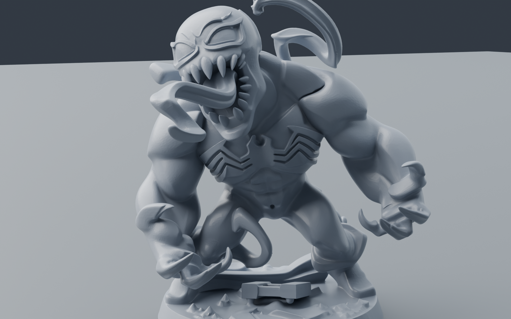
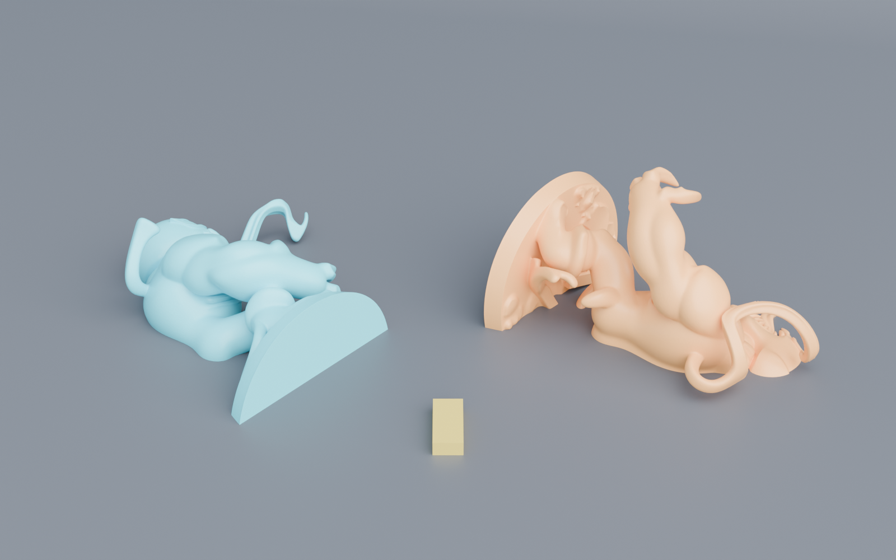
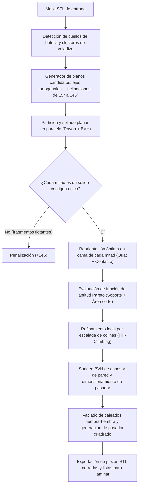

# Slyser

Slyser particiona mallas STL de forma inteligente para minimizar o eliminar la necesidad de estructuras de soporte en impresión 3D FDM. Analiza la geometría en paralelo mediante jerarquías de volúmenes envolventes (BVH), evalúa cientos de planos de corte inclinados sobre cuellos de botella morfológicos y reorienta cada pieza resultante sobre su base óptima en la cama de impresión ($Z=0$). Incorpora sellado hermético (watertight), cajeados hembra-hembra con holgura configurable para ensamblaje y generación automática de pasadores cuadrados de alineación, garantizando que cada pieza sea un único sólido contiguo sin pérdida de geometría.

## Características principales

- **Partición óptima multiobjetivo (Pareto):** Minimiza el volumen total de soporte integrando la penalización por área de corte y asegurando adherencia a la cama.
- **Exploración angular densa y refinamiento local:** Barre planos inclinados (de ±5° a ±45° en cabeceo y balanceo) sobre cuellos geométricos y centroides de voladizo, seguido de una optimización local por escalada de colinas (hill climbing).
- **Garantía de sólido contiguo único:** Penaliza cortes que dividan la malla en islas desconectadas o fragmentos flotantes. Conserva el 100% del volumen y la topología original sin descartar componentes.
- **Cajeados hembra adaptativos con análisis de espesor de pared:** Sondea la pared interna mediante trazado de rayos BVH desde el plano de corte, asegurando una pared sólida mínima de 1,8 mm y evitando perforaciones en la superficie exterior del modelo.
- **Pasadores de ensamblaje cuadrados:** Genera pasadores macho independientes con holgura diametral FDM (0,2 mm por cara por defecto) y holgura axial de 0,4 mm para un asiento plano entre piezas.
- **Rendimiento multinúcleo nativo en Rust:** Paralelización total con Rayon y aceleración BVH con intersección de rayos Möller-Trumbore.

## Comparativa visual

| Modelo original sin cortar | Piezas orientadas en cama (Z=0) |
|:---:|:---:|
|  |  |
| **Volumen de soporte:** 4.788,43 mm³<br>(3.421,58 mm³ sobre el propio modelo) | **Volumen de soporte combinado:** 1.795,25 mm³<br>(**-62,5%** de reducción total) |

## Instalación y compilación

Requiere el compilador de Rust (edición 2021) y Cargo.

```bash
git clone https://github.com/Dgmtnz/Slyser.git
cd Slyser
cargo build --release
```

El binario optimizado se genera en `./target/release/slyser`.

## Uso del CLI

### 1. Partición automática con pasadores (flujo principal)

Ejecuta la búsqueda exhaustiva de planos de corte, cajeado hembra, generación de clavijas y colocación en cama:

```bash
slyser partition \
  --input modelo.stl \
  --output-dir ./salida \
  --max-pieces 2 \
  --angle 45.0 \
  --pins \
  --pin-size 4.0 \
  --pin-depth 5.0 \
  --pin-clearance 0.2
```

Salida generada en el directorio destino:
- `piece_1.stl`: Primera mitad cerrada, orientada en $Z=0$ con cajeado hembra.
- `piece_2.stl`: Segunda mitad cerrada, orientada en $Z=0$ con cajeado hembra.
- `pin_1.stl`: Pasador cuadrado calibrado con holgura para impresión plana.

### 2. Análisis geométrico de voladizos y soporte

Calcula el área en voladizo, la proyección en XY y el volumen de soporte estimado hacia la cama y hacia el modelo:

```bash
slyser analyze --input modelo.stl --angle 45.0
```

### 3. Orientación óptima sobre la cama

Busca la rotación en el espacio tridimensional que minimiza los soportes sin realizar cortes:

```bash
slyser orient --input modelo.stl --output modelo_orientado.stl --angle 45.0
```

### 4. Corte plano manual con cajeado

Corta la malla por un punto y un vector normal definidos, generando mitades herméticas y pasador:

```bash
slyser cut \
  --input modelo.stl \
  --point "112.18,108.59,20.68" \
  --normal "0.766,-0.643,-0.009" \
  --output-prefix ./corte \
  --pins
```

### 5. Inspección de malla

Muestra información dimensional, volumen cerrado, área superficial y centro de masa:

```bash
slyser info --input modelo.stl
```

## Validación en modelo complejo (Venom)

Evaluación comparativa ejecutada sobre el modelo `VenomEscalado.stl` (148.804 triángulos, figura orgánica con dientes, lengua prominente y peana con pedestal):

| Parámetro | Modelo original | Pieza 1 (Frontal) | Pieza 2 (Dorsal) | Pasador 1 | Resultado combinado |
|---|---:|---:|---:|---:|---:|
| **Dimensiones (mm)** | 39,07 × 32,30 × 42,37 | 38,73 × 50,24 × 14,65 | 45,71 × 41,78 × 23,53 | 4,00 × 4,00 × 9,60 | — |
| **Triángulos** | 148.804 | 72.324 | 82.690 | 12 | 155.026 |
| **Volumen de soporte (mm³)** | 4.788,43 | 651,60 | 1.143,65 | 0,00 | **1.795,25** |
| **Soporte sobre el modelo (mm³)** | 3.421,58 | 156,25 | 390,21 | 0,00 | **546,46 (-84,0%)** |
| **Área en voladizo (mm²)** | 1.300,36 | 569,50 | 582,04 | 0,00 | 1.151,54 |
| **Área contacto cama (mm²)** | 344,12 | 373,51 | 281,72 | 16,00 | 671,23 (+95,1%) |
| **Sólido contiguo único** | Sí (1 comp.) | Sí (1 comp.) | Sí (1 comp.) | Sí (1 comp.) | **Garantizado** |
| **Hermeticidad (Manifold)** | Sí | Sí | Sí | Sí | **100% 2-manifold** |
| **Reducción de soporte** | 0% | — | — | — | **-62,5%** |

### Detalles del corte en Venom
- **Plano óptimo:** Centro en `(112.18, 108.59, 20.68)`, normal `(0.766, -0.643, -0.009)` (inclinación de ~40° en XY).
- **Conservación geométrica:** 100% del volumen preservado (error < 0,01% previo a la sustracción volumétrica del cajeado).
- **Protección de pared:** La profundidad de cajeado se limitó adaptativamente mediante sondeo BVH interno, manteniendo más de 1,8 mm de pared sólida en ambas caras y evitando agujeros en la superficie externa.

## Arquitectura y algoritmo



1. **Estimador de voladizos (BVH):** Utiliza un árbol de cajas alineadas con los ejes (AABB) con división por mediana e intersección de rayos Möller-Trumbore vectorizada. Lanza rayos verticales descendentes desde los centros de los triángulos con ángulo respecto a la vertical superior al umbral configurado, diferenciando soportes que caen a la cama de soportes que caen sobre la propia pieza.
2. **Generador de planos de corte:** Aplica el teorema de Green para obtener el área de sección transversal a lo largo de los ejes principales, localiza mínimos locales (estrechamientos anatómicos) y aplica rotaciones en cabeceo y balanceo en pasos de 5° para encontrar planos que no intersecten geometrías desconectadas adyacentes.
3. **Sellado planar y triangulación:** Divide los triángulos que intersecan el plano mediante interpolación de aristas, reconstruye las curvas cerradas perimetrales en 2D en la base ortonormal del plano y triangula la tapa mediante corte de orejas (ear clipping), garantizando que las normales apunten hacia el exterior en ambos hemisferios.
4. **Cajeado hembra y clavijas:** Proyecta la sección de corte en 2D, calcula el polígono mayor y ubica el pasador con holguras. Comprueba mediante rayos internos el grosor restante hasta la carcasa exterior. Sustrae la caja cuadrangular en el plano de corte e inserta las caras laterales y fondo de cavidad emparejadas con precisión de vértices compartidos.

## Comprobaciones y pruebas

La suite de pruebas automatizadas verifica la hermeticidad topológica, la invariancia volumétrica y el comportamiento en casos extremos:

```bash
cargo test
cargo clippy --all-targets -- -D warnings
```

Las 61 pruebas unitarias e integradas cubren:
- Lectura y escritura binaria/ASCII STL con conservación de normales y coordenadas.
- Trazado de rayos y cálculo analítico de volumen de soporte en sólidos sintéticos (bloques con voladizos a 90° exactos).
- Rotaciones cuaterniónicas y estabilidad de centro de masas sobre polígonos de apoyo.
- Conservación volumétrica en cortes ortogonales y oblicuos con sellado hermético.
- Tolerancias y dimensionamiento adaptativo de pasadores y cajeados.
- Algoritmo de componentes conexas y rechazo de planos de corte fragmentarios.

## Licencia

Distribuido bajo la Licencia MIT. Consulta el archivo `LICENSE` para más información.
